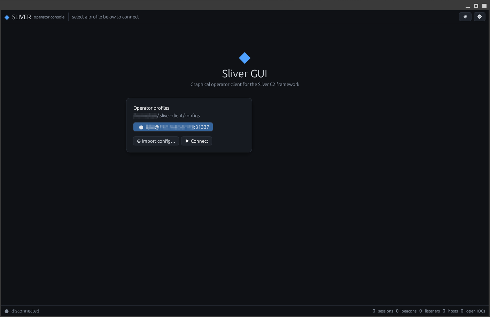
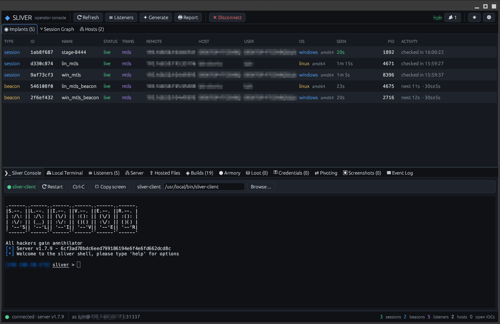
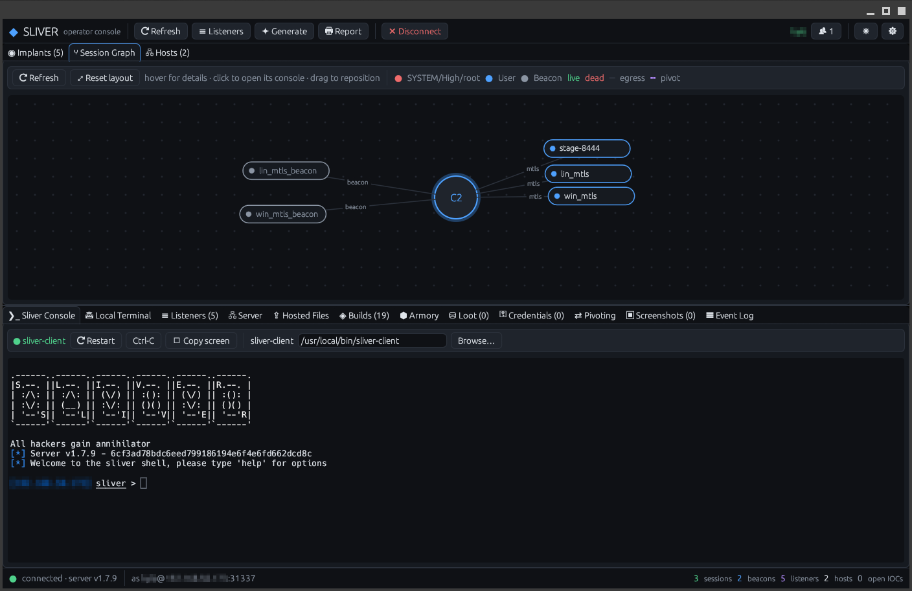

# Sliver GUI

A graphical operator client for the [**Sliver**](https://github.com/BishopFox/sliver) C2
framework, written in Rust with [egui](https://github.com/emilk/egui). It connects to a
standard Sliver server over the operator gRPC API (mTLS), using the same operator
profiles as the official `sliver-client`. No server changes and no plugins needed.

It's a point-and-click operator workspace: a live table of sessions and beacons, a
session graph, dockable tabs for each implant, file and process browsers, listener and
payload management, loot and credentials, pivoting, hosted files, and the real Sliver
console embedded right next to it.

> **Under active development.** This is an early release. Some features need more
> testing in different environments, so expect bugs and rough edges. Please report what
> you find in the issue tracker.

> **Authorized use only.** This is offensive-security tooling for authorized penetration
> tests, red-team engagements, research and lab work. Only use it against systems you own
> or have explicit written permission to test.

## Screenshots

**Login**: pick an operator profile (or import one) and connect.



**Interface**: the live Implants table, with the embedded Sliver Console and the other
tabs below.



**Session Graph**: implants around the C2 hub; hover a chip for its details.



---

## Installation

### Option A: prebuilt binary (Linux x86_64)

Download `sliver-gui-v0.1.0-linux-x86_64.tar.gz` from the
[Releases](../../releases) page, check it and run it:

```bash
sha256sum -c sliver-gui-v0.1.0-linux-x86_64.tar.gz.sha256
tar xzf sliver-gui-v0.1.0-linux-x86_64.tar.gz
./sliver-gui-v0.1.0-linux-x86_64/sliver-gui
```

It needs glibc 2.35 or newer (Ubuntu 22.04+, Debian 12+, Kali, Fedora 36+) and a
graphical desktop. If it won't start, install the desktop runtime libraries:
`sudo apt install libxkbcommon0 libwayland-client0 libx11-6 libgl1 libegl1 libfontconfig1`.

### Option B: build from source

#### Prerequisites

- A recent **stable Rust** toolchain: <https://rustup.rs>
- A C compiler, **CMake** and **pkg-config** (for `aws-lc-rs`, the TLS crypto backend)
- **Linux desktop libraries.** On Debian / Ubuntu / Kali:

  ```bash
  sudo apt update
  sudo apt install build-essential cmake pkg-config curl \
    libxkbcommon-dev libwayland-dev libx11-dev libxcursor-dev libxrandr-dev libxi-dev \
    libgl1-mesa-dev libegl1-mesa-dev libgbm-dev libfontconfig1-dev libssl-dev \
    fonts-dejavu-core fonts-noto-core
  ```

  Other distros need the equivalents: a C toolchain, cmake, pkg-config, xkbcommon,
  wayland, X11 (Xcursor, Xrandr, Xi), Mesa GL/EGL, fontconfig and DejaVu/Noto fonts.

This release is built and tested on **Linux x86_64**. It's portable Rust and should also
build on Windows (MSVC toolchain + CMake; `aws-lc` may need NASM) and macOS, but those
builds haven't been tested yet.

No `protoc` is needed. The Sliver protobufs in `proto/` are compiled at build time by the
pure-Rust [`protox`](https://crates.io/crates/protox).

#### Build

```bash
git clone <this repository>
cd sliver-gui
cargo build --release
./target/release/sliver-gui
```

### Optional tools

These are only needed for the features that use them. **⚙ Settings → Environment** shows
whether each one was found, and lets you **Browse…** to it if it isn't on your `PATH`.

| Tool | Used for |
|---|---|
| `sliver-client` (same version as your server) | the **Sliver Console** tab |
| `msfvenom` | building stager stubs for staged payloads |

---

## Getting started

### 1. Create an operator config on the Sliver server

The GUI connects with an operator **config** (`.cfg`) file, and only the Sliver server
can create one. On the **server host**:

```bash
# Start the server with its operator API listening (port 31337 by default).
sliver-server daemon --lhost 0.0.0.0 --lport 31337

# Create a config for yourself.
sliver-server operator --name <you> --lhost <server-address> \
  --lport 31337 --permissions all --save ./<you>.cfg
```

For `operator`, `--lhost` is the address the GUI will **connect to**, so use the
server's reachable IP or hostname, never `0.0.0.0`.

From the interactive `sliver-server` console you can do the same with
`multiplayer --lport 31337` followed by
`new-operator --name <you> --lhost <server-address> --save <path>`.

### 2. Import it into Sliver GUI

Copy `<you>.cfg` to the machine running the GUI, then either:

- **Import in the GUI:** launch `sliver-gui`, click **⊕ Import config…** and pick the
  file. It's copied into `~/.sliver-client/configs/`.
- **Or copy it there yourself:**

  ```bash
  mkdir -p ~/.sliver-client/configs
  cp <you>.cfg ~/.sliver-client/configs/
  chmod 600 ~/.sliver-client/configs/<you>.cfg
  ```

  The GUI lists every config in that folder when it starts.

> A `.cfg` contains your operator private key. Keep it private and never commit it (this
> repository's `.gitignore` excludes `*.cfg`).

### 3. Connect

Select your config and click **▶ Connect**. Then start a C2 listener from the
**Listeners** tab, build an implant with **✦ Generate**, and run it on your target.
Sessions and beacons appear in the **Implants** table as they call back.

---

## Features in this release

**Implants**
- One live **Implants** table for sessions and beacons: type, ID, name, status,
  transport, remote address, host, user, OS, last seen, PID, and activity (last check-in,
  or a beacon's next check-in and pending tasks). Right-click a row for its actions.
- **Session Graph**: compact chips around the C2 hub, coloured by privilege, with pivot
  chains drawn as dashed edges. Hover a chip for its details; click it to open a console.
- Per-implant **consoles** with Tab completion and history, an **interactive shell**
  (raw or PTY), and **beacon task history** with results and cancel.
- **Ping**, **open an interactive session from a beacon**, **close session**,
  **reconfigure** a beacon's interval, rename, kill / remove.

**On the target**
- **File browser**: breadcrumbs, recent folders, mounts, upload / download, preview,
  copy / move / rename, chmod / chown, delete, content search, and add to loot.
- **Process browser** (table or tree view) with kill.
- **Windows registry** browser and **services** view (details, start / stop / remove).
- **Modules**, offered per OS: .NET assemblies, sideload, spawn-DLL, BOFs, Armory
  extensions, WASM extensions, environment variables, and quick actions (ifconfig,
  netstat, whoami, privileges, tokens…).

**Server**
- **Listeners**: mTLS, HTTP(S) (self-signed, your own certificate, or Let's Encrypt),
  DNS, WireGuard and TCP stage listeners; edit, clone, restart, saved presets.
- **Payload generator**: sessions or beacons for Windows / Linux / macOS on any
  transport, with execution limits, saved profiles and build history. Warns when the
  server can't compile the chosen target.
- **Hosted files**: host a file for download over your HTTP(S) listeners (Sliver's
  websites), with one-click download commands.
- **Server tab**: certificates and CAs, compile targets, external builders, and the AI
  assistant's saved conversations.
- **Pivoting**: SOCKS5 proxies, local and reverse port-forwards, implant chaining (TCP /
  named-pipe pivot listeners) and WireGuard tunnels.
- **Loot & credentials**: add, preview, rename and save loot; manage credentials with
  hash types, a type filter and server-side hash detection.
- **Hosts & IOCs** with operator notes and a cleanup checklist.
- **Armory** browser with minisign-verified installs.

**Built in**
- **Sliver Console**: the official `sliver-client` in an embedded terminal.
- **Local Terminal**: a shell on the machine running the GUI (zsh, bash, PowerShell…).
- **Logging & reporting**: timestamped daily logs (with UTC offset) of operator actions,
  terminal command lines and events; a Markdown engagement report with one merged
  timeline; CSV export. Input that isn't shown on screen, such as typed passwords, is
  never logged.
- Dark and light themes, a dockable layout that's remembered, and notifications for new
  callbacks.

For a detailed guide to every feature, see [docs/REFERENCE.md](docs/REFERENCE.md).

---

## Acknowledgements

Huge thanks to **[Bishop Fox](https://bishopfox.com)** for creating, open-sourcing and
maintaining [**Sliver**](https://github.com/BishopFox/sliver), and to
**[moloch--](https://github.com/moloch--)**, Sliver's creator and lead developer, and all
of Sliver's contributors. This GUI only exists because Sliver is such a capable, well-built
framework. Please star and support [the Sliver project](https://github.com/BishopFox/sliver)
and read its documentation at [sliver.sh](https://sliver.sh).

Built with [egui / eframe](https://github.com/emilk/egui),
[egui_dock](https://github.com/Adanos020/egui_dock), [tonic](https://github.com/hyperium/tonic),
[rustls](https://github.com/rustls/rustls) with
[aws-lc-rs](https://github.com/aws/aws-lc-rs), [protox](https://github.com/andrewhickman/protox),
[vt100](https://crates.io/crates/vt100) and [portable-pty](https://crates.io/crates/portable-pty).

This project is not affiliated with or endorsed by Bishop Fox.

---

## License

GPL-3.0. See [LICENSE](LICENSE). The vendored files in `proto/` come from
[Sliver](https://github.com/BishopFox/sliver), which is also GPL-3.0.
